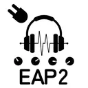

# External Audio Processing 2 for AviUtl ExEdit2

**External Audio Processing 2** は AviUtl ExEdit2 上でオーディオプラグイン (VST&reg;3 / CLAP) を利用可能にするフィルタプラグインです。
その他音声関連機能も付属しています。

## 注意事項 / Disclaimer

- 無保証です。自己責任で使用してください。  
このプラグインを利用したことによる、いかなる損害・トラブルについても責任を負いません。

- すべてのVST3/CLAPプラグインとの完全な互換性を保証するものではありません。  
プラグインの実装によっては、GUIが正常に表示されない、動作が不安定になる、あるいはAviUtl2がクラッシュする可能性があります。  
不具合を発見した場合報告していただけるとありがたいです。

- v0.0.xの内は開発初期のリリースです。  
致命的な不具合や破壊的変更などが起こりやすいと思われます。  
使用する際はバックアップを取っておくことをおすすめします。

> - This plugin is provided "as is" without any warranty. Use it at your own risk.
> - The author is not responsible for any damages, losses, or issues arising from the use of this plugin.
> - Compatibility with all VST3/CLAP plugins is not guaranteed. Depending on the plugin implementation, the GUI may not display correctly, the plugin may behave unstably, or AviUtl2 may crash. Bug reports are appreciated.
> - Versions 0.0.x are early development releases and may contain critical bugs or breaking changes. Backing up your projects before use is strongly recommended.

## 推奨事項

このプラグインはVST3プラグインの利用を主機能としたものです。  
VST3プラグインをお持ちでない場合や、AviUtl ExEdit2内でより手軽に本格的な音声加工を行いたい場合は、  
**うつぼかずら様**の制作された以下のプラグインを導入することを強くおすすめします。

- **Utsbox Audio Effect for AviUtl ExEdit2**
  - <https://www.utsbox.com/>

このプラグインは互換性維持のため一部パラメータ名が分かりにくい場合があります。  
そのため**Garech様**の制作された以下の言語ファイルを導入することをおすすめします。
2026.03.31版以降が本プラグインに対応しています。  
Tipsが表示されない事が有るため  
利用している言語ファイルの`SubLanguage`の項目の最後に`,Default`が無い場合  
`,Default`を追記することをお勧めします

- **AviUtl2 スクリプト日本語化パッチ**
  - <https://github.com/Garech-mas/script_jp_patch.aul2>

## 動作要件

- AviUtl ExEdit2 version2.1.13以降(2.1.13で動作確認をしています)
  - <https://spring-fragrance.mints.ne.jp/aviutl>
  - バージョンアップによって仕様が変更された場合動作しない可能性があります。
  - 初代AviUtlでは[初代External_Audio_Processing](https://github.com/Book-0225/aviutl_External_Audio_Processing)を利用してください。(一部の機能のみ)

- Visual C++ 再頒布可能パッケージ（v14 の x64 対応版が必要）
  - <https://learn.microsoft.com/ja-jp/cpp/windows/latest-supported-vc-redist>

## インストール

### au2pkg.zipファイルを利用する場合

1. リリースページから最新版の `External_Audio_Processing2.au2pkg.zip` をダウンロードします。
2. `External_Audio_Processing2.au2pkg.zip`ファイルを、  
  AviUtl ExEdit2のウィンドウにドラッグアンドドロップしてください。

### AviUtl2 カタログを利用する場合

#### 注意事項

- AviUtl2 カタログへの更新の登録は遅れる場合があります。

#### 手順

1. [AviUtl2 カタログ](https://github.com/Neosku/aviutl2-catalog) 内で`External Audio Processing 2`または`EAP2`で検索します。
2. インストールボタンを押すと導入出来ます。

## 読んでほしいこと

詳細は [既知の問題](docs/known-issues.md) を参照してください。

- **ルートシーンで使う**: Host / Notes Send はルート以外のシーンでは正しく動作しません。また、プロジェクト保存時もルートシーンを開いておく必要があります。
- **設定変更は「選択 → 再生カーソルを重ねる」**: オブジェクトを選択し、再生カーソルをその範囲内に置いた状態で操作しないと設定が反映されません。
- **書き出し前に一度通し再生**: 初期化遅延による冒頭のノイズ・音途切れを防げます。

## ドキュメント

- [Host (VST3 / CLAP)](docs/host.md) - オーディオプラグインを読み込むメインフィルタ
- [内蔵フィルタ](docs/builtin-filters.md) - Utility / EQ / Dynamics / Reverb / Pitch Shift など
- [チェインフィルタ](docs/chain-filters.md) - Send と Comp 等をIDで連動させるサイドチェイン系
- [内蔵メディアオブジェクト](docs/media-objects.md) - Generator / MIDI Generator / MIDI Visualizer など
- [EAP2 Analyzer](docs/analyzer.md) - ラウドネス解析ツール
- [投げ込み機能](docs/dropin.md) - .vst3 / .clap / .mid のドラッグ&ドロップ
- [設定ファイル](docs/configuration.md) - External_Audio_Processing2.ini の解説
- [既知の問題](docs/known-issues.md) - 操作上の注意・トラブルシューティング
- [ビルド方法](docs/build.md)
- [改版履歴](CHANGELOG.md)
- [サードパーティライセンス](THIRD_PARTY_LICENSES.md)

## License

このプロジェクトはMIT Licenseの下で公開されています
